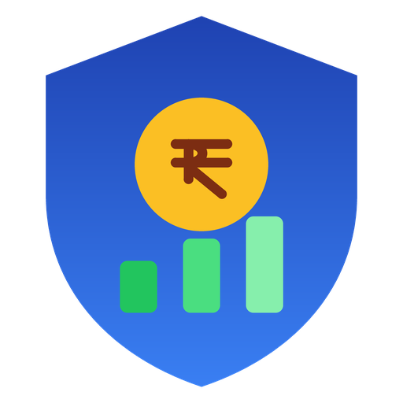
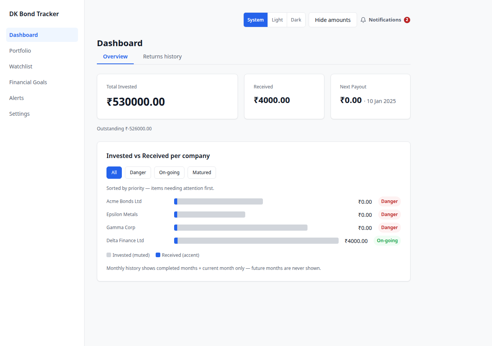
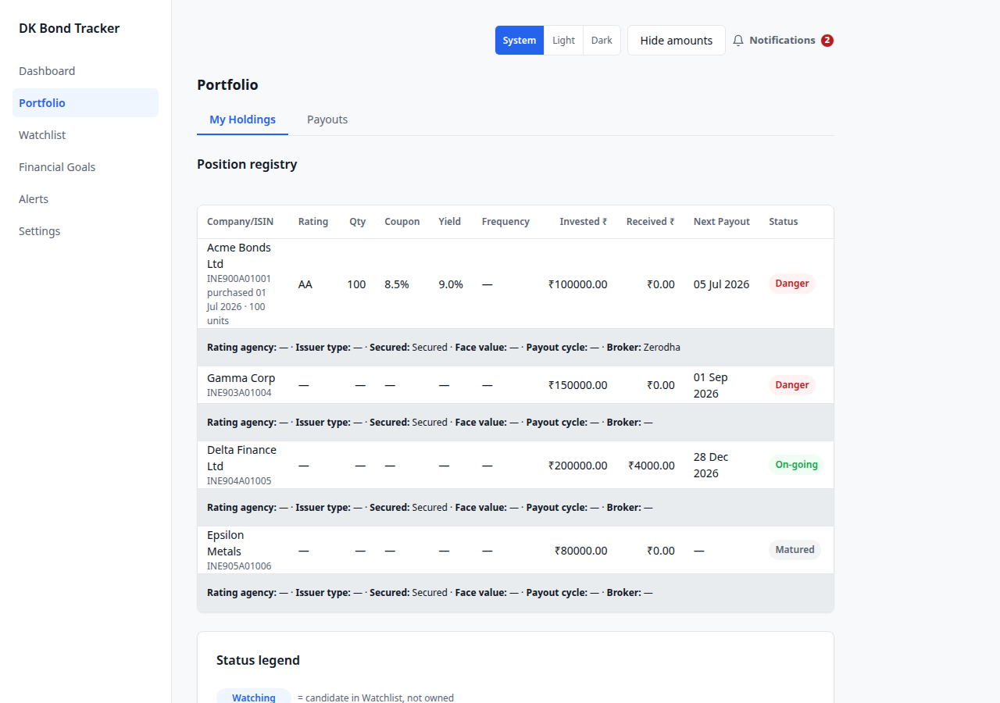
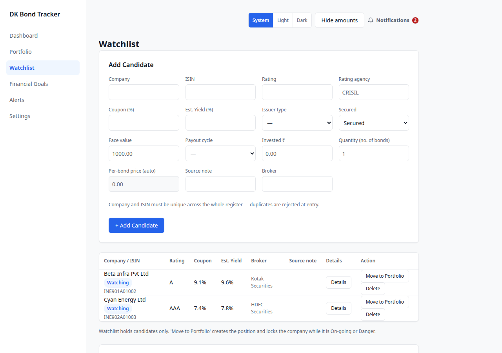
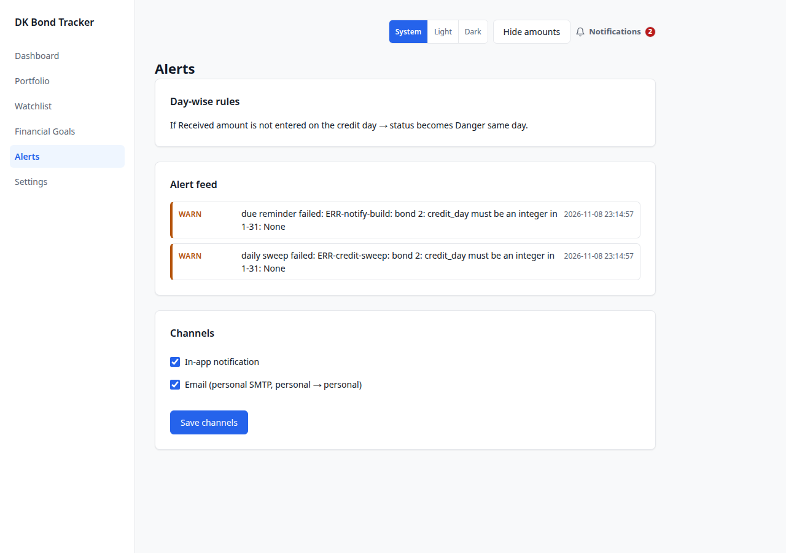
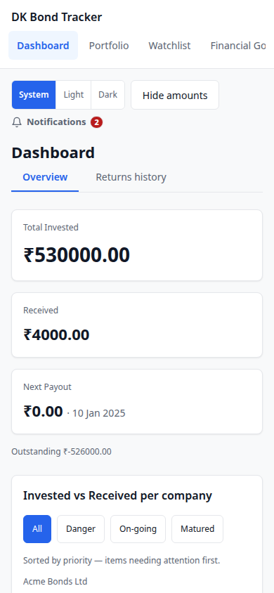
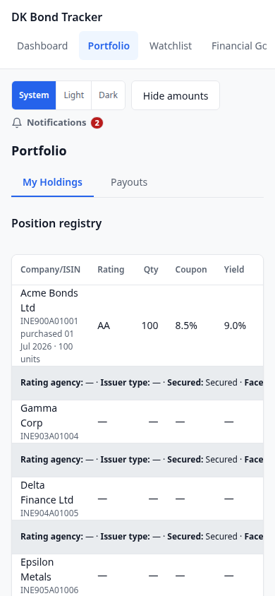
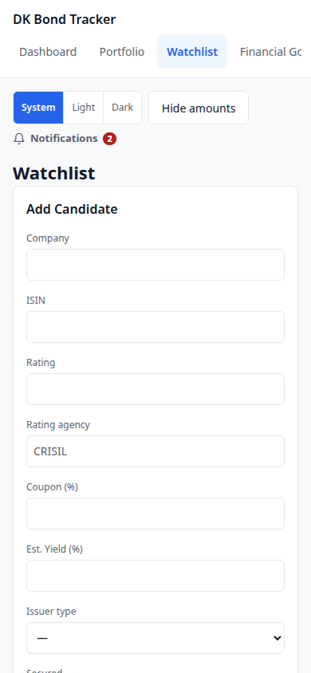

<p align="center">
  
</p>

<h1 align="center">DK Bond Tracker</h1>

<p align="center">
  <b>Offline bond portfolio tracker.</b> Local SQLite + Flask.<br>
  No cloud, no accounts, no telemetry — your data never leaves your machine.
</p>

<p align="center">
  
  
  
  
  
</p>

---

## Highlights

- **Fully offline.** One SQLite file, `data/bonds.db`. No network calls, no accounts, no analytics.
- **One payment ledger.** Every payment is a row, not a month column — so months are not hardcoded and the history is not capped.
- **Live dashboard and status.** Status recomputes the moment a payment changes; no open/save step.
- **Danger means any unpaid past month**, not just the previous one.
- **Desktop and Android from one core.** The APK packages the real `src/` through Chaquopy, so there is exactly one copy of the logic.
- **Exports and sharing.** CSV export, a share page, and a monthly print view.
- **Privacy toggle** in the header masks money amounts on screen, in the browser only.

## Why this exists

This replaced a macro-enabled Excel workbook. Its VBA rebuilt the dashboard on every open and save behind a blocking dialog, month headers were hardcoded from Sep-2025 to Feb-2027, the month scan stopped at Jan-2031, the "Danger" check looked only at the previous month, and errors were silently swallowed by `On Error Resume Next`. The dashboard was a stale snapshot between saves, and sharing meant emailing the whole workbook.

The rebuild keeps what worked — a month grid, a dashboard, a status view — and fixes the rest.

## Screenshots

Desktop:

| Dashboard | Holdings |
| --- | --- |
|  |  |

| Watch list | Alerts |
| --- | --- |
|  |  |

On a phone:

| Dashboard | Holdings | Watch list |
| --- | --- | --- |
|  |  |  |

## Quick start

Requires **Python 3.10 or newer** and a browser. That is the whole requirement list.

```bash
git clone https://github.com/Adi-Mudi/dk-bond-tracker.git
cd dk-bond-tracker
./setup.sh          # creates .venv and installs Flask
./run.sh            # starts the app
```

Then open <http://127.0.0.1:5000>.

On Windows use `setup.bat` then `run.bat`.

If `./setup.sh` is blocked by your shell permissions, run `bash setup.sh`.

**The app starts empty.** There is no sample data and nothing is imported automatically — add your own companies from **Watch List → Add position**.

To stop the app, press `Ctrl+C` in the terminal.

## Android

Download `dk-bond-tracker-android-v1.0.4-dev-debug.apk` from the [latest release](https://github.com/Adi-Mudi/dk-bond-tracker/releases), then install it. The app runs the same Flask core on-device and shows it in a WebView.

> **This APK is a debug build.** It carries an ephemeral signature, so it cannot upgrade an existing install in place — Android rejects it with `INSTALL_FAILED_UPDATE_INCOMPATIBLE`. Uninstall any previous copy first. Producing a release-signed APK needs the project keystore, which is deliberately not in the repository; see [`android/SIGNING.md`](android/SIGNING.md).

### Building the APK from source

Needs a JDK, the Android SDK (platform 34, build-tools), and a Python 3.13 for Chaquopy's bytecode step:

```bash
cd android
export JAVA_HOME=/path/to/jdk-21
export ANDROID_HOME=/path/to/android-sdk
echo "sdk.dir=$ANDROID_HOME" > local.properties
./gradlew --no-daemon \
  -Pdkbt.buildPython=/path/to/python3.13 \
  :app:assembleDebug
```

The APK lands in `android/app/build/outputs/apk/debug/app-debug.apk`.

> `android/build_debug.sh` and `android/build_release.sh` exist, but they hardcode toolchain paths under `android/spike/tools/`, which is gitignored and not present in a fresh clone. Use the explicit command above, or restore that directory layout yourself.

## Your data and privacy

Everything lives in one file: `data/bonds.db`, next to the app. Delete it and you have a fresh install; copy it and you have a backup.

Nothing is sent anywhere. There is no account, no sync, and no usage reporting. The only outbound network traffic the app can make is email, and only if you configure it — see below.

The header carries a privacy toggle that masks money amounts on screen. It is stored in your browser, not in the database.

## Email alerts (optional)

Email is off until you configure it. There are two ways, and environment variables win over the in-app values.

**Option 1 — in the app.** Settings → email, where you enter the sending address and an app password. These are stored in your local database.

**Option 2 — environment variables**, set before `./run.sh`:

| Variable | Purpose |
| --- | --- |
| `SMTP_HOST` | SMTP server. Defaults to the Gmail host. |
| `SMTP_PORT` | SMTP port, if not the default. |
| `SMTP_USER` | Login / sender address. Required for sending. |
| `SMTP_APP_PASSWORD` | App password for that account. Required for sending. |
| `ALERT_TO` | Recipient. Defaults to `SMTP_USER`. |
| `SMTP_STARTTLS` | Set to `1` to force STARTTLS. |

```bash
export SMTP_USER=you@example.com
export SMTP_APP_PASSWORD=your-app-password
export ALERT_TO=you@example.com
./run.sh
```

Gmail via OAuth 2.0 is also supported (Settings → connect Gmail), which sends through the Gmail API instead of raw SMTP and avoids storing an app password.

If SMTP is unconfigured the app says so on the settings page rather than failing silently.

## Project structure

```
src/            the Flask application
  app.py          application factory and the --db entry point
  views/          one module per page (dashboard, portfolio, watch, goals, ...)
  queries/        detail, grid, history, summary query builders
  templates/      Jinja templates (23)
  static/         CSS, JS, logo assets
  engine.py       status engine
  db.py           schema, migrations, init_db
  mailer.py       SMTP
  gmail_oauth.py  Gmail OAuth 2.0 (stdlib only)
  ledger.py       payment ledger
android/        Gradle + Chaquopy wrapper that packages src/ into an APK
tests/          pytest suite (110 files)
scripts/        build_product.sh, test_local.sh, test_remote.sh, smoke_local.py
docs/           born-JSON requirement streams and the design catalog
data/           your SQLite database (created on first run)
```

`store/` is a symlink to a `db-store` worktree that holds the project's documentation database — the requirement, test and traceability records. It is a generated projection of the JSON streams in `docs/`.

## Testing

```bash
./scripts/test_local.sh     # fast tier — 789 tests, about 25 seconds
./scripts/test_remote.sh    # full tier — 846 tests
```

The suite is organised around the acceptance criteria in the requirement stream, so test names trace back to individual requirements. Continuous integration runs the full tier on every push and pull request, and separately builds the Android debug APK.

## Releases

| Version | Notes |
| --- | --- |
| `v1.0.4` | UI/UX layout redesign, layout permanent fix, Android core product, single version source |
| `v1.0.3` | Layout fix and de-clutter pass |
| `v1.0.2` | Android core product |
| `v1.0.1` | First tagged release |

Full notes and downloads are on the [releases page](https://github.com/Adi-Mudi/dk-bond-tracker/releases).

## Roadmap

Designed but not built yet, tracked in [Discussion #194](https://github.com/Adi-Mudi/dk-bond-tracker/discussions/194):

1. **Liquidity score per bond** — NSE bhavcopy, local lookups, liquid/active/thin/none tiers.
2. **TDS** — Section 193 / 393 rules, threshold handling, exemption profiles, a financial-year summary. The app records what happened; it is not tax advice.
3. **Fixed-income analytics** — Macaulay and modified duration, convexity, DV01, rate shock.
4. **ISIN autofetch** into a local bond master (instrument facts only, never position facts).
5. **P&L and a Performance tab** — per-bond performance engine, invested vs received, XIRR.
6. **Credit rating journey** — upgrade/downgrade tracking from issue date.

## Known limitations

- **L1/L2 features are held** and are not in the current build.
- **No release-signed Android APK.** Only a debug build is producible here; the keystore is not in the repository.
- **No market pricing.** Market value and unrealised market P&L wait on a settled price source.
- **The repository is private**, so release download links require GitHub access. Anonymous downloads return 404 by design.

## Contributing

Issues and pull requests are welcome. Before opening a pull request:

```bash
./scripts/test_local.sh     # must stay green
```

Please keep changes scoped to a single issue, and note which files you touched. The project tracks work as issues with a documented plan per change, so opening an issue before a non-trivial pull request saves everyone time.

## License

MIT — see [LICENSE](LICENSE). Copyright (c) 2026 Divakaran (Adi-Mudi).

## Acknowledgements

- [Flask](https://flask.palletsprojects.com/), the only runtime dependency.
- [Chaquopy](https://chaquo.com/chaquopy/) for embedding Python in the Android build.
- [pytest](https://pytest.org/) for the test suite.
- Upstream research for the roadmap: [`captn3m0/india-isin-data`](https://github.com/captn3m0/india-isin-data) (CC0, NSDL access) and `bond-screener` (liquidity algorithm ideas; no licence, ideas only).
